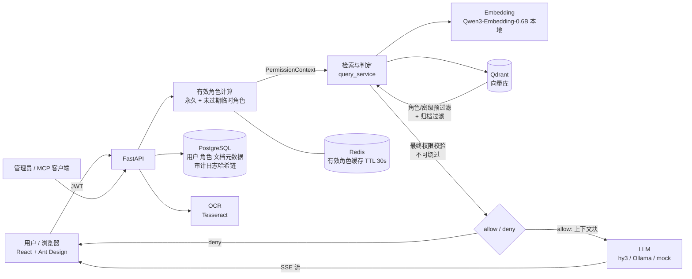

# Aspire Internal Brain

**RBAC-aware internal knowledge assistant.** Employees ask questions in natural language (text or a photo of a note); the system answers from internal documents **only from what that person is entitled to read**, cites its sources, and writes every query, denial and permission change to a tamper-evident audit log.

员工用自然语言（文字或图片）查询企业内部知识；系统在检索阶段就按 **角色 / 密级 / 需知分区** 做权限过滤，只用该用户有权访问的文档生成回答并附来源引用；所有查询、拒绝和权限变更都写入带哈希链的审计日志。

> 项目背景：Tencent Cloud AI CAN DO IT Hackathon Singapore 2026，FinTech 赛道（Aspire）。需求与范围裁剪见 [`readme.txt`](readme.txt)，演示脚本见 [`requirement/demo_script.md`](requirement/demo_script.md)。

---

## 目录

1. [功能概览](#功能概览)
2. [架构](#架构)
3. [快速开始](#快速开始)
4. [配置参考](#配置参考)
5. [演示账号与文档库](#演示账号与文档库)
6. [权限模型](#权限模型)
7. [检索与回答流水线](#检索与回答流水线)
8. [API 与管理后台](#api-与管理后台)
9. [测试与评测](#测试与评测)
10. [项目结构](#项目结构)
11. [常见问题](#常见问题)
12. [已知限制与范围外](#已知限制与范围外)
13. [安全注意事项](#安全注意事项)
14. [相关文档](#相关文档)

---

## 功能概览

| 方面 | 内容 |
|---|---|
| 问答 | 文字查询、图片查询（OCR → 同一条权限流水线）；回答**流式**显示，附来源文档标签；中英文混合检索 |
| 权限 | `allowed_roles ∧ required_clearance ≤ 用户密级 ∧ compartments ⊆ 用户分区`，向量检索前置过滤 + 应用层最终校验 |
| 有效角色 | 永久角色 + 未过期的临时/项目角色，授予与撤销立即生效（Redis 缓存带主动失效） |
| 临时角色 | 管理员直接授予、项目成员（加入自动授权 / 移出自动撤销）、用户申请 + 审批 |
| 版本治理 | 归档（archived）版本保留在库里但**永远不会被引用** |
| 审计 | 每次查询（allow / deny）、登录、授权与撤销都追加写入；哈希链可校验；支持筛选、CSV/JSON 导出 |
| 管理后台 | 角色管理、审计日志（含链完整性校验）、Dashboard（查询量、拒绝率、越权告警） |
| 安全 | 检索内容作为**不可信数据**交给模型（提示词注入防护）；授权从不依赖模型 |
| 审计问答 | 只读 MCP 服务（`/mcp`）+ **WorkBuddy** 作为前端智能体：管理员用自然语言问"过去一周谁越权查询过薪酬文档"，智能体自己组合工具查证；被拒记录会标出用户**想看的受限文档**（仅审计可见）。见 [`requirement/workbuddy/`](requirement/workbuddy/README.md) |

---

## 架构



要点：

- **权限在检索阶段发生**：被拒内容不会进入模型上下文，因此不存在"模型被诱导说出来"的路径；拒绝响应不含文档标题或 ID。
- **后端可插拔**：embedding（`local` / `hunyuan` / `mock`）、LLM（`anthropic` / `openai_compat` / `hunyuan` / `deepseek` / `mock`）、向量库（`qdrant` / `tencent_vectordb`）、OCR（`tesseract` / `tencent`）都通过环境变量切换。

---

## 快速开始

### 前置条件

- Docker 与 Docker Compose（建议 ≥ 8 GB 内存、≥ 10 GB 磁盘）
- 网络：首次启动要下载 Python / Node 镜像与依赖，以及 embedding 模型 `Qwen/Qwen3-Embedding-0.6B`（约 1.2 GB，缓存在 `hf_cache` 卷）
- 回答生成需要一个 LLM（三选一，见下）

### 1. 配置

```bash
cp backend/.env.example backend/.env
```

编辑 `backend/.env`，选择 LLM：

| 方式 | 配置 |
|---|---|
| **腾讯 hy3（推荐）** | `LLM_BACKEND=openai_compat`，`LLM_BASE_URL=https://tokenhub.tencentmaas.com/v1`，`LLM_MODEL=hy3`，`LLM_API_KEY=<TokenHub API Key>`。通过腾讯 TokenHub 的 OpenAI 兼容端点调用混元 hy3 大模型。 |
| **本地 Ollama** | 宿主机运行 `ollama pull qwen2.5:7b`；`LLM_BACKEND=openai_compat`，`LLM_BASE_URL=http://host.docker.internal:11434/v1`，`LLM_MODEL=qwen2.5:7b`，`LLM_API_KEY=ollama`。纯 CPU 下一次回答约 20–70 秒。 |
| **无 LLM（仅检索）** | `LLM_BACKEND=mock`：返回检索到的原文摘录，不生成。 |

> LLM 调用失败时系统不会报错，而是自动降级为"原文摘录"并在开头注明。

### 2. 启动

```bash
./start.sh            # 启动全部服务；数据库为空时自动写入种子数据
./start.sh --reset    # 清空数据卷后重新开始（演示前推荐）
./stop.sh             # 停止，保留数据
./stop.sh --purge     # 停止并删除数据卷
```

`start.sh` 依次：`docker compose up -d --build` → 等待后端健康 → 数据库迁移 → （库为空时）`seed_data.py` + `seed_vectorstore.py` + 审计哈希链回填 → 打印地址与账号。

> **首次向量化约 20 分钟**（CPU 上每个块约 3 秒，共 348 个块）。结果缓存在 `backend/.embed_cache.sqlite`，之后重新入库近乎瞬时。

### 3. 访问

| 服务 | 地址 |
|---|---|
| 前端 | http://localhost:5173 |
| 管理后台（独立站点，仅 `admin` 账号） | http://localhost:5174 |
| 后端 API / 文档 | http://localhost:8000 · http://localhost:8000/docs |
| MCP（只读，需管理员 JWT） | http://localhost:8000/mcp |

登录页选择模拟 SSO 账号即可（无密码）。后端启动时会在后台预热 embedding 模型，几秒后首次查询不再有冷启动延迟。

---

## 文档库（COS）

`data/` **不再由 git 管理**。文档（含 `manifest.json`）放在**私有**的腾讯云 COS 桶里，并镜像到本地 `./data`（系统实际索引的就是它）。

- **更新文档**：直接在桶里上传 / 替换 / 删除（目录结构与 `data/` 相同，包括 `manifest.json`）。
- **同步到 VM**：`./install_cos_sync_cron.sh` 安装每 5 分钟一次的定时任务，在后端容器里执行 `python sync_data_from_cos.py`：新增、变更的文件会下载，COS 里已删除的文件会在本地删除，随后文档库监听器在 `LIBRARY_SYNC_INTERVAL` 秒内重新索引。也可手动执行，加 `--dry-run` 只预览。
- **安全保护**：桶为空或没有 `manifest.json` 时拒绝同步；一次要删除的本地文件超过 `--max-delete`（默认 3）个时拒绝删除，确认无误后加 `--force`。
- **首次部署**：`data/manifest.json` 不存在时，`deploy.sh` 会自动从 COS 下载。
- 回答下方的"查看原文"是 `GET /api/documents/{id}/link` 在通过与检索相同的权限校验后签发的短时效链接，桶必须保持私有。

## 配置参考

配置在 `backend/.env`（容器通过 `env_file` 读取）。`backend/.env.example` 是推荐的起点；`app/core/config.py` 中的默认值（多为 `mock`）只在变量缺失时生效。

| 变量 | 说明 | 示例 / 默认 |
|---|---|---|
| `DATABASE_URL` / `REDIS_URL` | 元数据库与缓存；docker-compose 会覆盖为容器内地址 | |
| `JWT_SECRET` / `JWT_EXPIRE_MINUTES` | 登录令牌；**部署前必须改 `JWT_SECRET`** | 480 分钟 |
| `VECTOR_BACKEND` | `qdrant` \| `tencent_vectordb` | `qdrant` |
| `EMBEDDING_BACKEND` | `local` \| `hunyuan` \| `mock` | `local` |
| `LOCAL_EMBEDDING_MODEL` | `local` 时使用的 sentence-transformers 模型 | `Qwen/Qwen3-Embedding-0.6B`（1024 维） |
| `LLM_BACKEND` | `anthropic` \| `openai_compat` \| `hunyuan` \| `deepseek` \| `mock` | `openai_compat`（hy3） |
| `ANTHROPIC_API_KEY` / `ANTHROPIC_MODEL` / `ANTHROPIC_EFFORT` / `ANTHROPIC_WORKSPACE_ID` | Claude 配置（可选，`LLM_BACKEND=anthropic` 时使用） | `claude-sonnet-5-5` / `low` |
| `LLM_BASE_URL` / `LLM_MODEL` / `LLM_API_KEY` | OpenAI 兼容端点（hy3 via TokenHub、Ollama、vLLM 等） | `https://tokenhub.tencentmaas.com/v1` / `hy3` |
| `OCR_BACKEND` | `tesseract` \| `tencent` | `tesseract` |
| `RELEVANCE_THRESHOLD` | 相关性门槛：低于它的块不算"有答案" | `0.42` |
| `DENY_MARGIN` / `DENY_STRONG_SCORE` | "真正的答案是受限的"判定：不看权限的最佳匹配高出 ≥ margin，且用户自己的最佳匹配 < strong 时判为拒绝 | `0.15` / `0.58` |
| `SERVE_FLOOR` | 通过相关性门槛后，选上下文时放宽到的分数下限 | `0.40` |
| `RETRIEVE_K` / `SERVE_K` | 检索候选数 / 交给 LLM 的块数 | `10` / `5` |
| `NEIGHBOR_TOP` / `NEIGHBOR_WINDOW` | 为前 N 个命中补充前后相邻块（0 = 关闭） | `2` / `1` |
| `DATA_DIR` | 文档库根目录（含 `manifest.json`）；容器内 `/data` | `/data` |
| `EMBEDDING_CACHE_PATH` | embedding 磁盘缓存 | `.embed_cache.sqlite` |
| `TENCENT_SECRET_ID` / `TENCENT_SECRET_KEY` / `TENCENT_VECTORDB_*` | 腾讯云适配器（见[已知限制](#已知限制与范围外)） | |

> **阈值和 embedding 模型绑定**：`RELEVANCE_THRESHOLD`、`DENY_MARGIN`、`DENY_STRONG_SCORE`、`SERVE_FLOOR` 是针对 Qwen3-Embedding-0.6B + 当前切块在评测集上标定的。更换 embedding 模型或切块方式后必须重新标定（见 [`backend/eval/NOTES.md`](backend/eval/NOTES.md)）。

---

## 演示账号与文档库

### 账号（模拟 SSO，14 个）

| 账号 | 角色 | 密级 | 分区 |
|---|---|---|---|
| alice | compliance_officer | 2 | aml |
| carol | compliance_officer + mlro | 3 | aml |
| dave | risk_analyst | 3 | credit |
| erin | card_ops | 2 | — |
| frank | customer_support | 1 | — |
| gina | finance_analyst | 3 | finance |
| henry | hr_manager | 3 | hr |
| ivy | marketing_manager | 2 | — |
| jack | account_manager | 2 | — |
| bob | engineer | 2 | — |
| kate | security_engineer | 3 | security |
| leo | legal_counsel | 3 | legal |
| vera | exec | 4 | board, hr, finance |
| admin | platform_admin | 4 | aml, finance |

所有人隐含 `employee` 角色。**`admin` 只管理权限，不能读业务内容。** 项目角色（`proj_merger` 等）由管理员在后台授予或通过"加入项目"自动授予。

### 文档库（`data/`，53 份模拟文档，内容均为虚构）

按部门组织：`public/`、`compliance/`（含 `archive/` 旧版）、`risk_credit/`、`card_ops/`、`customer_support/`、`finance/`、`hr/`、`marketing/`、`sales_partnerships/`、`engineering_security/`、`legal/`、`projects/<项目>/`、`executive/`。格式含 PDF / Word / Excel / PPT / Markdown，密级 1–4 加需知分区。

- [`data/manifest.json`](data/manifest.json) / [`data/documents_index.csv`](data/documents_index.csv)：每份文档的 `allowed_roles`、`required_clearance`、`compartments`、`version`、`status`、内容哈希。**seed 脚本以它为准。**
- [`requirement/doc_permission_matrix.md`](requirement/doc_permission_matrix.md)：文档 × 账号的权限矩阵。
- 故意放入的测试夹具：已归档的 KYC 政策 v2（数字与 v3 不同，用于测版本治理）、含提示词注入句的供应商新闻稿（`public/Vendor_Newsletter_Oct2026.md`）。

### 重新入库

```bash
docker compose exec backend python seed_data.py          # 重置用户/角色/文档元数据
docker compose exec backend python seed_vectorstore.py   # 解析 → 切块 → 向量化 → 写入 Qdrant（会重建集合）
```

---

## 权限模型

对每个查询：

1. 取用户**有效角色** = 永久角色 + 未过期的临时/项目角色（`user_roles`，`end_at` 过期自动排除）。
2. 构造 `PermissionContext(roles, clearance, compartments)`。
3. 向量库预过滤：`allowed_roles ∩ roles ≠ ∅`、`required_clearance ≤ clearance`、状态非 archived/deleted。
4. **应用层最终校验**（`rbac_filter.py`，所有后端共用，不可绕过）：额外检查 `compartments ⊆ 用户分区`。
5. 通过门槛的块才进入上下文；拒绝时只返回"权限不足"，不泄露文档是否存在。

**allow / deny 的措辞判定**（只影响回答与审计的说法，不影响权限）：

| 情形 | 结果 |
|---|---|
| 可见范围内有相关块，且没有明显更相关的受限内容 | allow，生成回答并附来源 |
| 可见范围内的最佳匹配较弱，而不看权限的最佳匹配高出 ≥ `DENY_MARGIN` | deny（真正的答案是受限的） |
| 可见范围内没有相关块，但不看权限时有相关文档 | deny |
| 整个知识库都没有相关内容 | allow，回答"未检索到相关内容" |

---

## 检索与回答流水线

1. **解析**：PDF / Word / Excel / PPT / Markdown → 带章节信息的行（Excel 展平为 `列名: 值` 并保留工作表名）。
2. **切块**：按章节边界切；正文块约 800 字符，表格块约 1500 字符；每块带前缀 `[文档标题 | 部门 | 章节]`。
3. **向量化**：本地 Qwen3-Embedding-0.6B，1024 维；查询端带检索指令前缀（不加会明显掉点）。embedding 结果按内容哈希缓存。
4. **检索**：取 `RETRIEVE_K=10` 个候选 → 过相关性门槛 → 给 LLM `SERVE_K=5` 个，并补前两名的相邻块；同一文档的块按原文顺序排列。
5. **生成**：hy3（或其他后端）只依据 `<document>` 标签内的资料回答，并被告知这些内容是不可信数据；回答末尾标注来源。
6. **流式**：`POST /api/query/text/stream` 先发 `meta`（判定 + 来源），再发 `delta`（回答文本），最后 `done`。
7. **审计**：流结束时写入一行（含有效角色、过滤条件、命中文档、判定、延迟）。

**评测结果**（`backend/eval/`，152 题，中英文）：给 LLM 的上下文里含答案的比例 **0.98**，答案类题目的允许判定 **1.00**，受限事实暴露 **0**。完整历史与"为什么没做混合检索"见 [`backend/eval/NOTES.md`](backend/eval/NOTES.md)。

---

## API 与管理后台

### 用户

| 方法 | 路径 | 说明 |
|---|---|---|
| POST | `/api/auth/login` | 模拟 SSO，返回 JWT |
| GET | `/api/auth/me` | 当前用户与有效角色 |
| POST | `/api/query/text` | 文字查询（一次性返回） |
| POST | `/api/query/text/stream` | 文字查询（SSE：`meta` / `delta` / `done`） |
| POST | `/api/query/image` | 图片查询（OCR 后同一流水线） |
| GET/POST | `/api/roles`、`/api/role-requests`、`/api/role-requests/me` | 角色列表、提交 / 查看临时角色申请 |

### 管理（需 `platform_admin`）

| 方法 | 路径 | 说明 |
|---|---|---|
| GET | `/api/admin/roles`、`/api/admin/users`、`/api/admin/users/{id}/roles` | 角色、用户、授予记录 |
| POST | `/api/admin/roles/grant`、`/api/admin/roles/revoke` | 直接授予 / 撤销 |
| POST | `/api/admin/projects/join`、`/api/admin/projects/leave` | 项目成员（自动授权 / 自动撤销） |
| GET/POST | `/api/admin/role-requests`、`.../{id}/approve`、`.../{id}/reject` | 审批 |
| GET | `/api/admin/audit/logs`、`/logs/{id}`、`/export`、`/verify` | 审计查询、导出（CSV/JSON）、哈希链校验（日志含 `blocked_doc_ids`） |
| GET | `/api/admin/dashboard/stats` | 查询量、拒绝率、越权告警 |

前端页面：`/login`、`/app/query`、`/admin/roles`、`/admin/audit`、`/admin/dashboard`、`/admin/datasources`（静态说明页，见[限制](#已知限制与范围外)）。

### MCP（只读，供 WorkBuddy 等智能体做审计问答）

`/mcp`（streamable HTTP）。认证：`Authorization: Bearer <JWT>`，身份需为 `platform_admin` 或最小权限的只读身份 **`auditor`**（后者不能调用 REST 管理接口；用 `docker compose exec -T backend python mint_audit_token.py --days 30` 生成长期令牌）。

| 工具 | 用途 |
|---|---|
| `get_current_time` | 当前时间（UTC / 新加坡），用来换算"昨天""过去一周" |
| `audit_summary` | 按 用户 / 天 / 判定 / 事件类型 / **被拦文档** / 命中文档 汇总计数（回答"谁、多少次、哪份文档"） |
| `search_audit_logs` | 按关键词、用户名、判定、文档、时间窗口搜索；每行含用户名、时间（SGT）、被拦文档与标题 |
| `find_documents` | 用标题 / 部门关键词找 `doc_id` 及密级、分区 |
| `verify_audit_chain` | 校验审计哈希链 |
| `list_audit_logs` · `get_audit_log_detail` · `list_users` · `get_user_roles` · `list_role_requests` · `get_dashboard_stats` | 基础查询 |

**被拒时记录"被拦文档"**：用户被拒绝时，系统把不看权限时最相关的那份受限文档的 ID 写进审计日志（`blocked_doc_ids`，纳入哈希链）。它**只出现在审计日志和 MCP 输出里，从不出现在给用户的任何响应中**（有测试覆盖）。

验证：`docker compose exec -T backend python verify_workbuddy_mcp.py`（用官方 MCP 客户端按 WorkBuddy 的方式调用并断言结果）；`python demo_audit_agent.py "问题"`（用 hy3 当替身智能体，检验工具与指令，会产生少量 API 费用）。

---

## 测试与评测

```bash
# 后端测试（在容器内，约 2 分钟，用的是真实的 Postgres / Redis / Qdrant 与已入库的文档库）
docker compose exec backend python -m pytest -q

# 前端类型检查与构建
cd frontend && npx tsc -b && npm run build
```

- 测试固定 `LLM_BACKEND=mock`，不会产生 API 费用。
- 部分测试依赖已入库的演示数据（`seed_data.py` + `seed_vectorstore.py`），见各文件头部说明。
- `tests/test_doc_library_matrix.py`：14 个账号 × 10 个问题，断言每个引用的文档都在该账号的权限范围内且未归档。

**检索评测**（不调用 LLM，无费用）：

```bash
docker compose exec backend python -m eval.run_retrieval_eval --out eval/results/NAME.json -v
```

输出召回率（chunk recall@k、给 LLM 的上下文召回）、allow/deny 判定准确率，以及两项必须为 0 的安全指标（越权返回、受限事实暴露）。评测集 `backend/eval/retrieval_eval.jsonl`；改动检索、切块或阈值后都应重跑并对比 `eval/results/` 中的历史结果。

---

## 项目结构

```
.
├── start.sh / stop.sh            一键启动 / 停止
├── docker-compose.yml            postgres · redis · qdrant · backend · frontend
├── readme.txt                    需求执行版（范围与优先级）
├── README.md                     本文件
├── data/                         演示文档库（53 份）+ manifest.json
├── requirement/                  需求原文、权限矩阵、演示脚本与截图
├── backend/
│   ├── app/
│   │   ├── api/                  路由：auth · query(含流式) · admin_* · role_requests
│   │   ├── models/ · schemas/    SQLAlchemy 模型 · Pydantic 模型
│   │   ├── services/
│   │   │   ├── query_service.py  检索 + allow/deny 判定 + 生成
│   │   │   ├── doc_parser.py · ingestion.py   解析与切块
│   │   │   ├── embeddings/       local · hunyuan · mock · 磁盘缓存
│   │   │   ├── vectorstore/      qdrant · tencent · rbac_filter（最终校验）
│   │   │   ├── llm/              anthropic · openai_compat · hunyuan · deepseek · mock
│   │   │   ├── ocr/ · rbac.py · role_*.py · audit.py · dashboard.py
│   │   └── mcp_server.py         只读 MCP
│   ├── migrations/               Alembic
│   ├── seed_data.py              用户 / 角色 / 文档元数据（读 data/manifest.json）
│   ├── seed_vectorstore.py       解析 → 切块 → 向量化 → Qdrant
│   ├── seed_audit_history.py     预置一周审计历史（经真实流水线，时间回填）
│   ├── mint_audit_token.py       生成只读 auditor 的长期令牌（WorkBuddy 用）
│   ├── verify_workbuddy_mcp.py · demo_audit_agent.py   MCP 验证 / 替身智能体
│   ├── eval/                     检索评测集、运行器、历史结果与决策记录
│   └── tests/
├── frontend/                     React + TypeScript + Ant Design + Vite
└── infra/postgres/               预留目录（目前为空）
```

---

## 常见问题

| 现象 | 原因与处理 |
|---|---|
| 前台提示"查询失败，请稍后重试" | 看 `docker compose logs backend`。LLM 失败本身会降级为原文摘录，不会走到这里；常见是后端未启动完成或数据库未初始化。 |
| 回答开头有"（大模型暂时不可用，以下为检索到的原文摘录）" | LLM 调用失败。检查 `LLM_API_KEY`、`LLM_BASE_URL`、网络；TokenHub 返回 `401006` 时检查模型服务 ID 和 API Key 是否正确。 |
| 本地 LLM 连不上 | 容器访问宿主机用 `host.docker.internal`（compose 已配置 `extra_hosts`）；确认宿主机 Ollama 在监听 `11434`。 |
| TokenHub 返回 `401006 服务 ID 不存在` | 模型尚未在控制台开通"在线推理服务"，或 `model` 应填服务 ID 而非模型名。 |
| 第一次启动很慢 | 下载 embedding 模型 + CPU 上首次向量化约 20 分钟；之后走缓存。 |
| 无法下载 HuggingFace 模型 | 检查网络，或提前把模型放进 `hf_cache` 卷；`LocalEmbedder` 优先用本地缓存，缺失才联网。 |
| 换了 embedding 模型后效果变差 / 全部被拒 | 阈值需要重新标定；并重新执行 `seed_vectorstore.py`（维度必须与 `EMBEDDING_DIM` 一致）。 |
| 集合结构变了、检索报错 | `seed_vectorstore.py` 会重建 Qdrant 集合，重新执行即可。 |
| Dashboard 数字不是从零开始 | `./start.sh` 会预置一周审计历史（37 条，`model_id=seed-history`，经真实检索流水线生成、时间回填），用于审计问答演示。调试期间产生的其他记录用 `./start.sh --reset` 清空。 |
| 前端改动没生效 | 前端是带热更新的开发服务器（挂载 `./frontend`）；新增依赖后需 `docker compose exec frontend npm install`。 |

---

## 已知限制与范围外

**已实现并验证**：账号与角色、临时/项目角色、权限前置过滤、版本治理、文字/图片查询、流式输出、审计哈希链、Dashboard、MCP、检索评测。

**未实现（按 `readme.txt` 的范围裁剪，仅在架构上说明）**：PostgreSQL/Oracle CDC（Debezium + Kafka）、NAS 目录监听增量同步、蓝绿索引切换、多版本并存治理、术语映射层。文档库目前是批量导入。

**其他限制**：

- **语音查询**（`/api/query/audio`）未实现。
- **数据源管理页**是静态说明页，没有真实的同步任务或数据。
- **腾讯云适配器**（`hunyuan` embedding / LLM、`tencent_vectordb`、腾讯 OCR）代码已写好。TokenHub 在本环境下已开通：当前实际运行的是本地 Qwen3 embedding、腾讯 hy3 via TokenHub 生成、Qdrant、Tesseract。
- 腾讯向量库适配器的 `status`（归档）过滤只在 Python 层生效，没有下推到查询表达式；大库下可能少于 `top_k` 个结果。
- **拒绝措辞是基于相似度分数的启发式**：少数问题会得到"资料不足"的回答而不是明确的"权限不足"（评测里约 11/38 道受限题），此时没有任何受限事实暴露。
- 英文问题检索中文文档、中文问题检索英文文档都可用，但跨语言的相似度分数偏低，是排名靠后答案块的主要来源。
- 没有做混合检索与重排序：在 108 道有标准答案的题目上离线评估收益在噪声范围内（详见 `backend/eval/NOTES.md`）。

---

## 安全注意事项

- **密钥**：`backend/.env`、`frontend/.env`、`requirement/SecretKey.csv*`、`requirement/tokenhub.txt`、`requirement/claudkey.txt` 已在 `.gitignore` 中（项目目前不是 git 仓库，初始化后请先确认这些文件不会被提交）；**不要提交，也不要贴到聊天或工单里**。开发期间用过的密钥建议在演示/发布后轮换。
- 部署前修改 `JWT_SECRET`；模拟 SSO 登录（无密码）**只用于演示**，生产应接入真实 IdP。
- 文档库内容全部虚构，不含真实个人或客户数据。
- 审计日志是追加式 + 哈希链：能发现篡改，但不能阻止有数据库写权限的人修改后重算整条链；生产环境应把链头定期锚定到外部存储。

---

## 相关文档

| 文件 | 内容 |
|---|---|
| [`readme.txt`](readme.txt) | 需求执行版：范围、优先级、API 清单 |
| [`task.txt`](task.txt) | 开发任务分解与进度记录 |
| [`requirement/demo_script.md`](requirement/demo_script.md) | 8 分钟演示脚本、检查清单、Q&A 备答、已知限制、界面走查结果 |
| [`requirement/doc_permission_matrix.md`](requirement/doc_permission_matrix.md) | 文档 × 账号权限矩阵与演示场景对照 |
| [`requirement/workbuddy/`](requirement/workbuddy/README.md) | WorkBuddy 审计问答：配置、智能体指令、试问清单、使用证明说明 |
| [`requirement/demo_assets/`](requirement/demo_assets) | 图片查询素材与界面截图 |
| [`backend/eval/NOTES.md`](backend/eval/NOTES.md) | 检索评测历史、实验数据与决策 |
| `requirement/Technical Proposal for RBAC AIG.docx` | 原始技术方案 |
