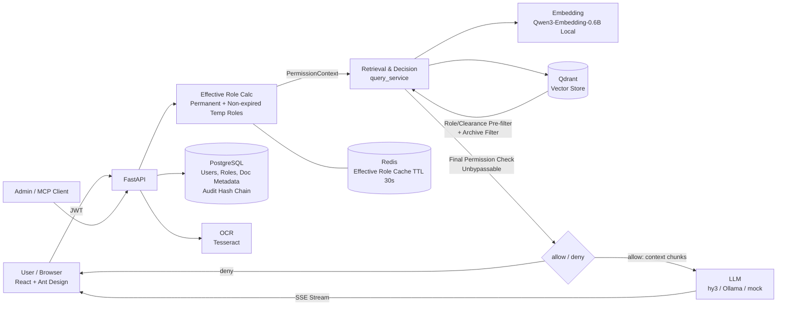

# Aspire Internal Brain

**RBAC-aware internal knowledge assistant.** Employees ask questions in natural language (text or a photo of a note); the system answers from internal documents **only from what that person is entitled to read**, cites its sources, and writes every query, denial and permission change to a tamper-evident audit log.

> Project background: Tencent Cloud AI CAN DO IT Hackathon Singapore 2026, FinTech track (Aspire).

---

## Table of Contents

1. [Feature Overview](#feature-overview)
2. [Architecture](#architecture)
3. [Quick Start](#quick-start)
4. [Configuration Reference](#configuration-reference)
5. [Demo Accounts & Document Library](#demo-accounts--document-library)
6. [Permission Model](#permission-model)
7. [Retrieval & Answer Pipeline](#retrieval--answer-pipeline)
8. [API & Admin Console](#api--admin-console)
9. [Testing & Evaluation](#testing--evaluation)
10. [Project Structure](#project-structure)
11. [FAQ](#faq)
12. [Known Limitations & Out of Scope](#known-limitations--out-of-scope)
13. [Security Notes](#security-notes)

---

## Feature Overview

| Aspect | Details |
|---|---|
| Q&A | Text queries, image queries (OCR → same permission pipeline); answers are **streamed** with source document labels; mixed Chinese/English retrieval |
| Permissions | `allowed_roles ∧ required_clearance ≤ user clearance ∧ compartments ⊆ user compartments`; vector retrieval pre-filter + application-layer final check |
| Effective Roles | Permanent roles + non-expired temporary/project roles; grant/revoke takes effect immediately (Redis cache with active invalidation) |
| Temporary Roles | Admin direct grant, project membership (auto-grant on join / auto-revoke on leave), user request + approval |
| Version Governance | Archived versions are retained in the store but **never referenced** |
| Audit | Every query (allow/deny), login, grant and revoke is append-written; hash-chain verifiable; supports filtering, CSV/JSON export |
| Admin Console | Role management, audit log (with chain integrity verification), Dashboard (query volume, denial rate, privilege escalation alerts) |
| Security | Retrieved content is treated as **untrusted data** fed to the model (prompt injection protection); authorization never depends on the model |
| Audit Q&A | Read-only MCP service (`/mcp`) + **WorkBuddy** as a front-end agent: admins ask in natural language "who queried salary docs without authorization last week" and the agent composes tools to investigate; denied records expose the restricted documents the user **wanted to see** (audit-only). |

---

## Architecture



Key points:

- **Permissions happen at retrieval time**: denied content never enters the model context, so there is no path for "model being coaxed into revealing it"; denial responses do not include document titles or IDs.
- **Pluggable backends**: embedding (`local` / `hunyuan` / `mock`), LLM (`anthropic` / `openai_compat` / `hunyuan` / `deepseek` / `mock`), vector store (`qdrant` / `tencent_vectordb`), OCR (`tesseract` / `tencent`) — all switchable via environment variables.

---

## Quick Start

### Prerequisites

- Docker and Docker Compose (recommend ≥ 8 GB RAM, ≥ 10 GB disk)
- Network: first launch downloads Python/Node images and dependencies, plus the embedding model `Qwen/Qwen3-Embedding-0.6B` (~1.2 GB, cached in `hf_cache` volume)
- An LLM for answer generation (pick one below)

### 1. Configuration

```bash
cp backend/.env.example backend/.env
```

Edit `backend/.env` and choose an LLM:

| Option | Configuration |
|---|---|
| **Tencent hy3 (Recommended)** | `LLM_BACKEND=openai_compat`, `LLM_BASE_URL=https://tokenhub.tencentmaas.com/v1`, `LLM_MODEL=hy3`, `LLM_API_KEY=<TokenHub API Key>`. Calls the Hunyuan hy3 model via Tencent TokenHub's OpenAI-compatible endpoint. |
| **Local Ollama** | Run `ollama pull qwen2.5:7b` on the host; `LLM_BACKEND=openai_compat`, `LLM_BASE_URL=http://host.docker.internal:11434/v1`, `LLM_MODEL=qwen2.5:7b`, `LLM_API_KEY=ollama`. CPU-only: ~20–70 seconds per answer. |
| **No LLM (retrieval only)** | `LLM_BACKEND=mock`: returns retrieved source excerpts without generation. |

> On LLM call failure, the system does not error out — it gracefully degrades to "source excerpts" with a note at the top.

### 2. Start

```bash
./start.sh            # Start all services; seeds data if database is empty
./start.sh --reset    # Wipe data volumes and start fresh (recommended before demos)
./stop.sh             # Stop, keep data
./stop.sh --purge     # Stop and delete data volumes
```

`start.sh` runs: `docker compose up -d --build` → wait for backend health → database migration → (if empty) `seed_data.py` + `seed_vectorstore.py` + audit hash chain backfill → print URLs and accounts.

> **First-time vectorization takes ~20 minutes** (CPU: ~3 seconds per chunk, 348 chunks total). Results are cached in `backend/.embed_cache.sqlite`; subsequent re-ingestion is nearly instant.

### 3. Access

| Service | URL |
|---|---|
| Frontend | http://localhost:5173 |
| Admin Console (separate site, `admin` account only) | http://localhost:5174 |
| Backend API / Docs | http://localhost:8000 · http://localhost:8000/docs |
| MCP (read-only, requires admin JWT) | http://localhost:8000/mcp |

On the login page, select a mock SSO account (no password). The backend pre-warms the embedding model on startup; after a few seconds, first query has no cold-start latency.

---

## Document Library in COS

`data/` is **not in git**. The documents (and `manifest.json`) live in a **private** Tencent COS bucket and are mirrored into `./data`, which is what gets indexed.

| Setting (`backend/.env`) | Meaning |
|---|---|
| `COS_SECRET_ID` / `COS_SECRET_KEY` | A sub-account limited to this bucket (read-only is enough) |
| `COS_REGION` / `COS_BUCKET` / `COS_PREFIX` | e.g. `ap-singapore` / `<name>-<appid>` / `data/` |

- **Update documents:** upload / replace / delete them in the bucket (same folder layout as `data/`, including `manifest.json`).
- **Sync into the VM:** `./install_cos_sync_cron.sh` installs a cron job (every 5 minutes) running `python sync_data_from_cos.py` in the backend container. New and changed files are downloaded, files deleted in COS are deleted locally, then the library watcher re-indexes within `LIBRARY_SYNC_INTERVAL` seconds. Run it by hand, or with `--dry-run`, from `docker compose exec -T backend python sync_data_from_cos.py`.
- **Safety:** it refuses to run on an empty bucket or one without `manifest.json`, and refuses to delete more than `--max-delete` (default 3) local files in one run unless `--force`.
- **First deployment:** `deploy.sh` downloads the library automatically when `data/manifest.json` is missing.
- **"View original" links** under answers are short-lived presigned URLs issued by `GET /api/documents/{id}/link` after the same RBAC check as retrieval; keep the bucket private.

## Configuration Reference

Configuration is in `backend/.env` (read by containers via `env_file`). `backend/.env.example` is the recommended starting point; defaults in `app/core/config.py` (mostly `mock`) apply only when variables are missing.

| Variable | Description | Example / Default |
|---|---|---|
| `DATABASE_URL` / `REDIS_URL` | Metadata DB and cache; docker-compose overrides to container addresses | |
| `JWT_SECRET` / `JWT_EXPIRE_MINUTES` | Login tokens; **must change `JWT_SECRET` before deployment** | 480 minutes |
| `VECTOR_BACKEND` | `qdrant` \| `tencent_vectordb` | `qdrant` |
| `EMBEDDING_BACKEND` | `local` \| `hunyuan` \| `mock` | `local` |
| `LOCAL_EMBEDDING_MODEL` | sentence-transformers model used by `local` | `Qwen/Qwen3-Embedding-0.6B` (1024-dim) |
| `LLM_BACKEND` | `anthropic` \| `openai_compat` \| `hunyuan` \| `deepseek` \| `mock` | `openai_compat` (hy3) |
| `ANTHROPIC_API_KEY` / `ANTHROPIC_MODEL` / `ANTHROPIC_EFFORT` / `ANTHROPIC_WORKSPACE_ID` | Claude config (optional, used when `LLM_BACKEND=anthropic`) | `claude-sonnet-5-5` / `low` |
| `LLM_BASE_URL` / `LLM_MODEL` / `LLM_API_KEY` | OpenAI-compatible endpoint (hy3 via TokenHub, Ollama, vLLM, etc.) | `https://tokenhub.tencentmaas.com/v1` / `hy3` |
| `OCR_BACKEND` | `tesseract` \| `tencent` | `tesseract` |
| `RELEVANCE_THRESHOLD` | Relevance cutoff: chunks below this are not considered "having an answer" | `0.42` |
| `DENY_MARGIN` / `DENY_STRONG_SCORE` | "The real answer is restricted" detection: best match ignoring permissions exceeds by ≥ margin, and user's own best match < strong → deny | `0.15` / `0.58` |
| `SERVE_FLOOR` | Score floor to relax to when selecting context after passing the threshold | `0.40` |
| `RETRIEVE_K` / `SERVE_K` | Retrieval candidates / chunks fed to LLM | `10` / `5` |
| `NEIGHBOR_TOP` / `NEIGHBOR_WINDOW` | Add adjacent chunks for the top N hits (0 = disabled) | `2` / `1` |
| `DATA_DIR` | Document library root (contains `manifest.json`); `/data` in container | `/data` |
| `EMBEDDING_CACHE_PATH` | Embedding disk cache | `.embed_cache.sqlite` |
| `TENCENT_SECRET_ID` / `TENCENT_SECRET_KEY` / `TENCENT_VECTORDB_*` | Tencent Cloud adapters (see [Known Limitations](#known-limitations--out-of-scope)) | |

> **Thresholds are tied to the embedding model**: `RELEVANCE_THRESHOLD`, `DENY_MARGIN`, `DENY_STRONG_SCORE`, `SERVE_FLOOR` are calibrated for Qwen3-Embedding-0.6B + current chunking on the evaluation set. Changing the embedding model or chunking strategy requires re-calibration (see [`backend/eval/NOTES.md`](backend/eval/NOTES.md)).

---

## Demo Accounts & Document Library

### Accounts (Mock SSO, 14 total)

| Account | Role | Clearance | Compartments |
|---|---|---|---|
| alice | compliance_officer | 2 | aml |
| carol | compliance_officer + mlro | 3 | aml |
| dave | risk_analyst | 3 | credit |
| erin | card_ops | 2 | — |
| frank | customer_support | 1 | — |
| gina | finance_analyst | 3 | finance |
| henry | hr_manager | 3 | hr |
| ivy | marketing_manager | 2 | — |
| jack | account_manager | 2 | — |
| bob | engineer | 2 | — |
| kate | security_engineer | 3 | security |
| leo | legal_counsel | 3 | legal |
| vera | exec | 4 | board, hr, finance |
| admin | platform_admin | 4 | aml, finance |

Everyone implicitly has the `employee` role. **`admin` manages permissions only — cannot read business content.** Project roles (`proj_merger`, etc.) are granted by admins or auto-granted via "join project."

### Document Library (`data/`, 53 mock documents, all fictional)

Organized by department: `public/`, `compliance/` (includes `archive/` old versions), `risk_credit/`, `card_ops/`, `customer_support/`, `finance/`, `hr/`, `marketing/`, `sales_partnerships/`, `engineering_security/`, `legal/`, `projects/<project>/`, `executive/`. Formats include PDF / Word / Excel / PPT / Markdown, clearance levels 1–4 plus need-to-know compartments.

- [`data/manifest.json`](data/manifest.json) / [`data/documents_index.csv`](data/documents_index.csv): Each document's `allowed_roles`, `required_clearance`, `compartments`, `version`, `status`, content hash. **Seed scripts use this as the source of truth.**
- Test fixtures intentionally included: archived KYC Policy v2 (numbers differ from v3, for testing version governance), a vendor newsletter containing prompt injection sentences (`public/Vendor_Newsletter_Oct2026.md`).

### Re-ingest

```bash
docker compose exec backend python seed_data.py          # Reset users/roles/document metadata
docker compose exec backend python seed_vectorstore.py   # Parse → chunk → vectorize → write to Qdrant (rebuilds collection)
```

---

## Permission Model

For each query:

1. Get user's **effective roles** = permanent roles + non-expired temporary/project roles (`user_roles`, `end_at` expiry auto-excluded).
2. Construct `PermissionContext(roles, clearance, compartments)`.
3. Vector store pre-filter: `allowed_roles ∩ roles ≠ ∅`, `required_clearance ≤ clearance`, status not archived/deleted.
4. **Application-layer final check** (`rbac_filter.py`, shared by all backends, unbypassable): additionally checks `compartments ⊆ user compartments`.
5. Only chunks passing the threshold enter the context; denials return only "insufficient permissions" without revealing whether the document exists.

**Allow/deny wording logic** (affects the answer and audit wording only, not permissions):

| Situation | Result |
|---|---|
| Relevant chunks in visible scope, no significantly more relevant restricted content | allow — generate answer with sources |
| Best match in visible scope is weak, and best match ignoring permissions exceeds by ≥ `DENY_MARGIN` | deny (the real answer is restricted) |
| No relevant chunks in visible scope, but relevant docs exist ignoring permissions | deny |
| No relevant content in the entire knowledge base | allow — answer "no relevant content found" |

---

## Retrieval & Answer Pipeline

1. **Parsing**: PDF / Word / Excel / PPT / Markdown → rows with section info (Excel flattened to `column: value`, sheet name preserved).
2. **Chunking**: Split at section boundaries; body chunks ~800 chars, table chunks ~1500 chars; each chunk prefixed with `[doc title | department | section]`.
3. **Embedding**: Local Qwen3-Embedding-0.6B, 1024-dim; query-side retrieval instruction prefix (omitting it noticeably hurts scores). Embedding results cached by content hash.
4. **Retrieval**: Fetch `RETRIEVE_K=10` candidates → pass relevance threshold → give LLM `SERVE_K=5`, plus adjacent chunks for the top 2; same-document chunks ordered by original position.
5. **Generation**: hy3 (or other backend) answers only from material inside `<document>` tags and is told this content is untrusted data; answer ends with source citations.
6. **Streaming**: `POST /api/query/text/stream` sends `meta` (decision + sources), then `delta` (answer text), then `done`.
7. **Audit**: One row written at stream end (including effective roles, filter conditions, hit documents, decision, latency).

**Evaluation results** (`backend/eval/`, 152 questions, Chinese/English): answer-in-context ratio **0.98**, allow accuracy for answerable questions **1.00**, restricted-fact exposure **0**. Full history and "why no hybrid retrieval" rationale in [`backend/eval/NOTES.md`](backend/eval/NOTES.md).

---

## API & Admin Console

### User

| Method | Path | Description |
|---|---|---|
| POST | `/api/auth/login` | Mock SSO, returns JWT |
| GET | `/api/auth/me` | Current user and effective roles |
| POST | `/api/query/text` | Text query (one-shot) |
| POST | `/api/query/text/stream` | Text query (SSE: `meta` / `delta` / `done`) |
| POST | `/api/query/image` | Image query (OCR → same pipeline) |
| GET/POST | `/api/roles`, `/api/role-requests`, `/api/role-requests/me` | Role list, submit/view temporary role requests |

### Admin (requires `platform_admin`)

| Method | Path | Description |
|---|---|---|
| GET | `/api/admin/roles`, `/api/admin/users`, `/api/admin/users/{id}/roles` | Roles, users, grant records |
| POST | `/api/admin/roles/grant`, `/api/admin/roles/revoke` | Direct grant/revoke |
| POST | `/api/admin/projects/join`, `/api/admin/projects/leave` | Project membership (auto-grant/auto-revoke) |
| GET/POST | `/api/admin/role-requests`, `.../{id}/approve`, `.../{id}/reject` | Approval workflow |
| GET | `/api/admin/audit/logs`, `/logs/{id}`, `/export`, `/verify` | Audit query, export (CSV/JSON), hash chain verification (logs include `blocked_doc_ids`) |
| GET | `/api/admin/dashboard/stats` | Query volume, denial rate, privilege escalation alerts |

Frontend pages: `/login`, `/app/query`, `/admin/roles`, `/admin/audit`, `/admin/dashboard`, `/admin/datasources` (static info page, see [Limitations](#known-limitations--out-of-scope)).

### MCP (read-only, for audit Q&A agents like WorkBuddy)

`/mcp` (streamable HTTP). Auth: `Authorization: Bearer <JWT>`, identity must be `platform_admin` or the minimal read-only identity **`auditor`** (the latter cannot call REST admin endpoints; generate a long-term token with `docker compose exec -T backend python mint_audit_token.py --days 30`).

| Tool | Purpose |
|---|---|
| `get_current_time` | Current time (UTC / Singapore), for resolving "yesterday" / "last week" |
| `audit_summary` | Aggregate counts by user/day/decision/event type/**blocked docs**/hit docs (answers "who, how many, which doc") |
| `search_audit_logs` | Search by keyword, username, decision, document, time window; each row includes username, time (SGT), blocked docs and titles |
| `find_documents` | Find `doc_id` and clearance/compartments by title/department keyword |
| `verify_audit_chain` | Verify audit hash chain |
| `list_audit_logs` · `get_audit_log_detail` · `list_users` · `get_user_roles` · `list_role_requests` · `get_dashboard_stats` | Basic queries |

**Denied queries record "blocked docs"**: when a user is denied, the system writes the most relevant restricted document ID (ignoring permissions) into the audit log (`blocked_doc_ids`, included in the hash chain). This **only appears in audit logs and MCP output — never in any user-facing response** (test-covered).

Verification: `docker compose exec -T backend python verify_workbuddy_mcp.py` (uses the official MCP client to call WorkBuddy-style queries and assert results); `python demo_audit_agent.py "question"` (uses hy3 as a proxy agent to test tools and instructions — incurs minor API cost).

---

## Testing & Evaluation

```bash
# Backend tests (in-container, ~2 minutes, uses real Postgres/Redis/Qdrant and ingested doc library)
docker compose exec backend python -m pytest -q

# Frontend type check and build
cd frontend && npx tsc -b && npm run build
```

- Tests pin `LLM_BACKEND=mock` — no API cost.
- Some tests depend on ingested demo data (`seed_data.py` + `seed_vectorstore.py`); see file headers.
- `tests/test_doc_library_matrix.py`: 14 accounts × 10 questions, asserts every cited document is within the account's permission scope and not archived.

**Retrieval evaluation** (no LLM calls, no cost):

```bash
docker compose exec backend python -m eval.run_retrieval_eval --out eval/results/NAME.json -v
```

Outputs recall (chunk recall@k, context recall for LLM), allow/deny decision accuracy, and two safety metrics that must be 0 (unauthorized return, restricted-fact exposure). Evaluation set: `backend/eval/retrieval_eval.jsonl`; re-run after changing retrieval, chunking, or thresholds and compare with historical results in `eval/results/`.

---

## Project Structure

```
.
├── start.sh / stop.sh            One-click start / stop
├── docker-compose.yml            postgres · redis · qdrant · backend · frontend
├── README.md                     This file (Chinese)
├── README_EN.md                  English version
├── data/                         Demo document library (53 docs) + manifest.json
├── backend/
│   ├── app/
│   │   ├── api/               Routes: auth · query (incl. streaming) · admin_* · role_requests
│   │   ├── models/ · schemas/    SQLAlchemy models · Pydantic models
│   │   ├── services/
│   │   │   ├── query_service.py  Retrieval + allow/deny decision + generation
│   │   │   ├── doc_parser.py · ingestion.py   Parsing and chunking
│   │   │   ├── embeddings/       local · hunyuan · mock · disk cache
│   │   │   ├── vectorstore/      qdrant · tencent · rbac_filter (final check)
│   │   │   ├── llm/              anthropic · openai_compat · hunyuan · deepseek · mock
│   │   │   ├── ocr/ · rbac.py · role_*.py · audit.py · dashboard.py
│   │   └── mcp_server.py         Read-only MCP
│   ├── migrations/               Alembic
│   ├── seed_data.py              Users / roles / document metadata (reads data/manifest.json)
│   ├── seed_vectorstore.py       Parse → chunk → vectorize → Qdrant
│   ├── seed_audit_history.py     Pre-seeds one week of audit history (via real pipeline, time backfilled)
│   ├── mint_audit_token.py       Generate long-term auditor token (for WorkBuddy)
│   ├── verify_workbuddy_mcp.py · demo_audit_agent.py   MCP verification / proxy agent
│   ├── eval/                     Retrieval eval set, runner, historical results and decision notes
│   └── tests/
├── frontend/                     React + TypeScript + Ant Design + Vite
└── infra/postgres/               Reserved directory (currently empty)
```

---

## FAQ

| Symptom | Cause & Fix |
|---|---|
| Frontend shows "Query failed, please retry" | Check `docker compose logs backend`. LLM failure itself degrades to source excerpts — won't reach this; usually backend not fully started or DB not initialized. |
| Answer starts with "(LLM temporarily unavailable, showing retrieved source excerpts)" | LLM call failed. Check `LLM_API_KEY`, `LLM_BASE_URL`, network; if TokenHub returns `401006`, verify model service ID and API Key. |
| Local LLM unreachable | Container accesses host via `host.docker.internal` (compose configures `extra_hosts`); confirm host Ollama is listening on `11434`. |
| TokenHub returns `401006 service ID not found` | Model "online inference service" not activated in console, or `model` should be the service ID rather than the model name. |
| First launch is slow | Downloading embedding model + CPU vectorization ~20 min; cached afterwards. |
| Cannot download HuggingFace model | Check network, or pre-place model in `hf_cache` volume; `LocalEmbedder` prefers local cache, falls back to download. |
| Switched embedding model → worse results / all denied | Thresholds need re-calibration; also re-run `seed_vectorstore.py` (dimensions must match `EMBEDDING_DIM`). |
| Collection schema changed, retrieval errors | `seed_vectorstore.py` rebuilds the Qdrant collection; re-run it. |
| Dashboard numbers don't start from zero | `./start.sh` pre-seeds one week of audit history (37 entries, `model_id=seed-history`, via real retrieval pipeline, time backfilled) for audit Q&A demos. Use `./start.sh --reset` to clear during debugging. |
| Frontend changes not taking effect | Frontend runs a dev server with hot reload (mounts `./frontend`); after adding dependencies run `docker compose exec frontend npm install`. |

---

## Known Limitations & Out of Scope

**Implemented and verified**: Accounts and roles, temporary/project roles, permission pre-filtering, version governance, text/image queries, streaming output, audit hash chain, Dashboard, MCP, retrieval evaluation.

**Not implemented (scoped out per original requirements, described architecturally only)**: PostgreSQL/Oracle CDC (Debezium + Kafka), NAS directory monitoring for incremental sync, blue-green index switching, multi-version coexistence governance, terminology mapping layer. Document library is currently batch-imported.

**Other limitations**:

- **Voice query** (`/api/query/audio`) not implemented.
- **Data source management page** is a static info page with no real sync tasks or data.
- **Tencent Cloud adapters** (`hunyuan` embedding/LLM, `tencent_vectordb`, Tencent OCR) code is written and ready. TokenHub is now active in this environment: currently running local Qwen3 embedding, Tencent hy3 via TokenHub for generation, Qdrant, Tesseract.
- Tencent vector DB adapter's `status` (archive) filter only works at the Python layer — not pushed down to the query expression; large stores may return fewer than `top_k` results.
- **Denial wording is similarity-score-based heuristics**: a few questions get "insufficient information" instead of a clear "insufficient permissions" (~11/38 restricted questions in eval), with zero restricted-fact exposure in these cases.
- Cross-lingual retrieval (English query → Chinese docs, Chinese query → English docs) works, but cross-lingual similarity scores are lower — the main source of lower-ranked answer chunks.
- No hybrid retrieval or re-ranking: offline evaluation on 108 answerable questions showed gains within noise range (see `backend/eval/NOTES.md`).

---

## Security Notes

- **Secrets**: `backend/.env`, `frontend/.env` are in `.gitignore` — **never commit, paste into chats, or include in tickets**. Rotate any keys used during development after demo/release.
- Change `JWT_SECRET` before deployment; mock SSO login (no password) is **demo-only** — production should integrate a real Idp.
- Document library content is entirely fictional — no real personal or customer data.
- Audit log is append-only + hash chain: it can detect tampering but cannot prevent someone with DB write access from modifying and recomputing the entire chain; production should periodically anchor the chain head to external storage.
